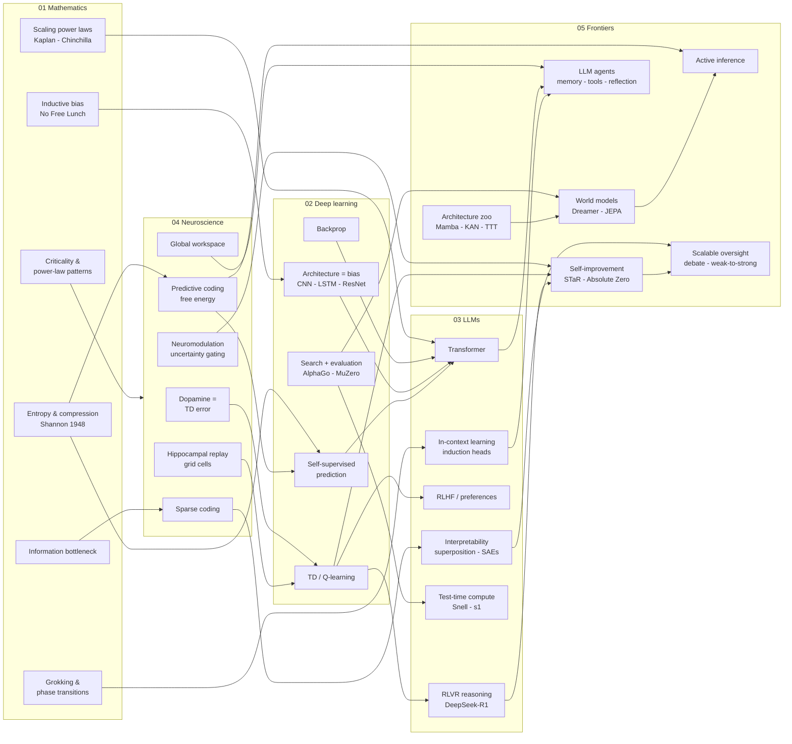

# Cross-Domain Map — How the Five Domains Connect

One graph linking the core ideas across all five domains. Color-by-subgraph; arrows mean "informs / grounds / enables."

## Five load-bearing connections (the TL;DR of the corpus)

1. **Shannon entropy ↔ cross-entropy loss ↔ free energy** (MATH → LLM/NEURO): the same quantity is minimized by the telegraph engineer, the LLM trainer, and (per Friston) the cortex. Compression is the universal objective.
2. **Dopamine ↔ Q-learning ↔ RLHF/RLVR** (NEURO → DL → LLM): the brain's reward-learning algorithm, formalized in machines, scaled with verifiable rewards to produce reasoning — and its pathologies (hacking, over-optimization) mirror addictions.
3. **Hippocampal replay ↔ experience replay ↔ agent memory** (NEURO → FRONT): memory is an active, prioritized, structuring process, not a log. Sleep ≈ consolidation phases for continual systems.
4. **AlphaGo's search ↔ test-time compute ↔ world models** (DL/LLM → FRONT): learned priors + explicit search at decision time — first in games, now in token space, next inside learned world models.
5. **Sparse coding ↔ superposition ↔ interpretability** (NEURO ↔ LLM): two substrates independently converged on packing more concepts than units via sparse geometry — and both needed dictionary methods to decode what they stored.
