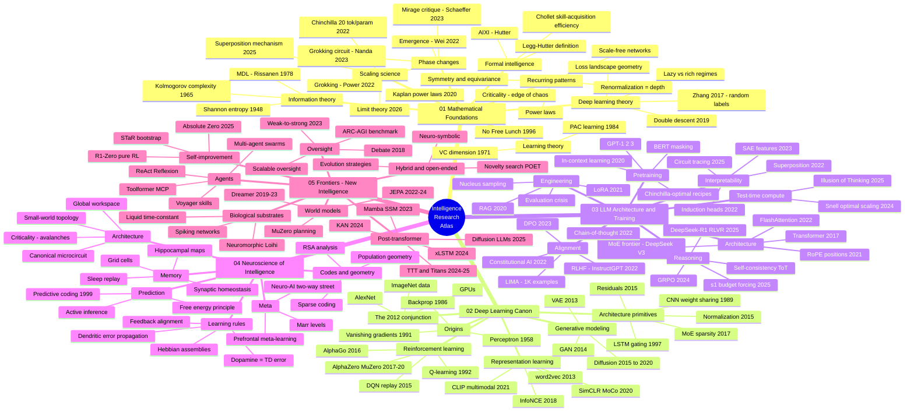

# Master Mindmap — The Whole Corpus

One map of everything in this atlas. Five domains branch from the root; leaves are the major ideas (details live in each domain's findings).

**How to use this map:** pick a leaf, then jump to the corresponding domain folder — `findings.md` files contain the full claim-evidence-implication treatment, and `papers.md` files carry the citations.
