# Timeline — Milestones of Intelligence Research (1943–2026)

```mermaid
timeline
    title Eighty Years of Intelligence Research
    1943 : McCulloch-Pitts neuron as logic
    1948 : Shannon information theory : Hebb cell assemblies (1949)
    1958 : Perceptron learns
    1969 : Minsky-Papert XOR proof - first AI winter begins
    1978 : MDL and compression-as-modeling (Rissanen)
    1982 : Hopfield energy networks : Oja Hebbian PCA
    1984 : PAC learning formalized
    1986 : Backpropagation revived (Rumelhart-Hinton-Williams)
    1989 : LeCun CNNs weight sharing
    1991 : Vanishing gradients named : World Wide Web begins (data era seed)
    1992 : Q-learning (Watkins) : LSTM (1997) : dopamine TD error (1997)
    1996 : Sparse coding from natural images
    1998 : Small-world networks
    1999 : Predictive coding in vision : Information bottleneck
    2003 : Neuronal avalanches - brain criticality (Beggs & Plenz)
    2005 : Grid cells in entorhinal cortex
    2009 : ImageNet dataset assembled
    2012 : AlexNet + GPUs - the deep learning big bang
    2013 : word2vec : VAE
    2014 : GAN : attention for translation : Adam : NTM
    2015 : ResNet : BatchNorm : DQN Atari : diffusion proposed
    2016 : AlphaGo beats Lee Sedol : DNC memory
    2017 : Transformer - Attention Is All You Need : MoE sparse layers : feedback alignment
    2018 : BERT and GPT-1 : pretrain-then-adapt era
    2020 : GPT-3 in-context learning : scaling laws (Kaplan) : DQN-to-... SimCLR-MoCo self-supervision : DDPM diffusion
    2021 : CLIP multimodal : LoRA
    2022 : Chinchilla 20 tok/param : InstructGPT RLHF - ChatGPT : Chain-of-thought : superposition : grokking : Stable Diffusion era
    2023 : GPT-4 : LLaMA open weights : DPO : ToT-ReAct agents : SAE monosemanticity : weak-to-strong
    2024 : Mamba - KAN - xLSTM architecture zoo : GRPO : DeepSeek-V3 : o1 test-time reasoning : DreamerV3 (2023) - JEPA
    2025 : DeepSeek-R1 RLVR - reasoning revolution (Nature) : s1 budget forcing : Illusion of Thinking critique : LLaDA diffusion LLMs : Titans : Absolute Zero self-play : circuit tracing
    2026 : Scaling-law limit theory matures : agentic deployment era : evaluation crisis front and center
```

## The three eras

1. **Symbolic & cybernetic era (1943–1986)** — neurons as logic, perceptrons, the first winter, learning theory foundations. Big lesson: representation without learning fails.
2. **Deep learning era (1986–2017)** — backprop, CNN/LSTM, the 2012 big bang, RL from pixels, AlphaGo. Big lesson: scale (data × compute × depth) + architectural bias beats hand-design.
3. **Foundation-model era (2017– )** — transformers, pretraining, alignment, reasoning RL, test-time compute. Big lesson: capability from pretraining, behavior from post-training, reasoning from RL + inference compute; measurement is now the bottleneck.
