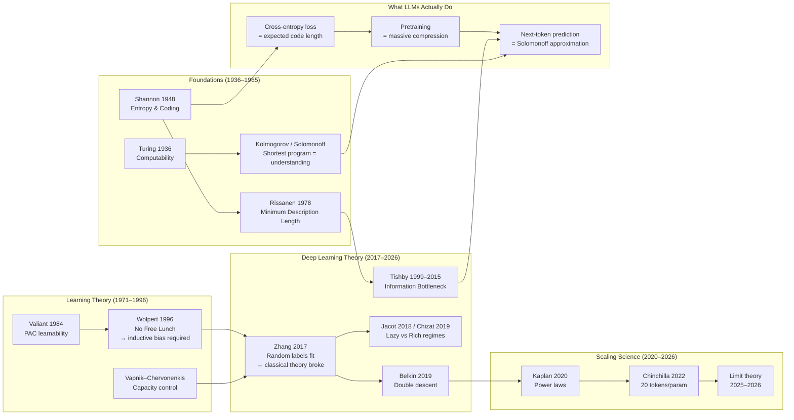

# Diagram — From Information Theory to Artificial Intelligence

How the mathematical lineage flows from 1948 information theory to modern LLM objectives. (Mermaid renders in Obsidian/GitHub.)

**Reading the map:** the top route (Shannon → MDL → IB) says *learning is compression*; the middle route (VC → Zhang → double descent) says *why deep nets surprised classical theory*; the bottom converges on scaling science, which turned compression into an engineering discipline.

Related: [scaling-emergence-grokking.mmd.md](scaling-emergence-grokking.mmd.md) · Cross-links to domain 03 (applied scaling) and domain 05 (AIXI-style definitions of intelligence).
