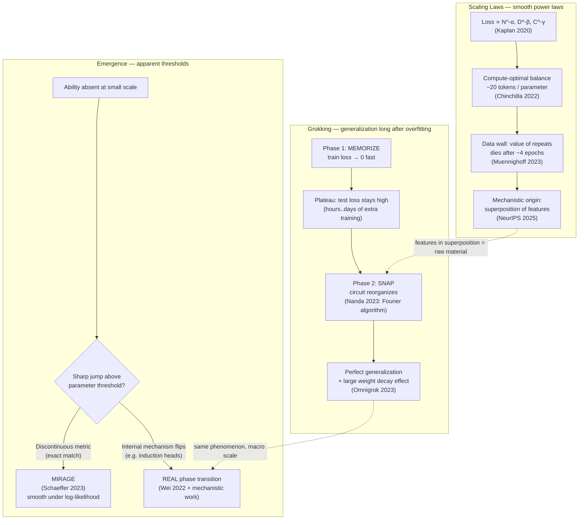

# Diagram — Scaling, Emergence, and Grokking (three faces of phase changes)

**Key insight:** all three phenomena are the same physics wearing different clothes — a system smoothly compressing until some internal structure snaps into a qualitatively better configuration. The knobs differ (scale / metrics / training time + weight decay), the pattern repeats.
