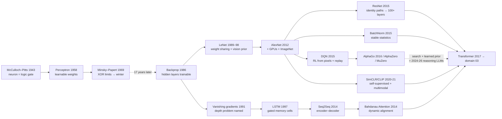

# Diagram — Architecture Evolution: 1943 → 2017

Each node is an architectural idea; arrows mean "enabled" or "fixed a limitation of."

**Pattern to notice:** only four architectural primitives survived into the transformer era — **weight sharing, gating, normalization, identity paths** — plus attention as the fifth. Everything else was scaffolding. (See findings F2/F3.)
