# Diagram — The Modern LLM Training Pipeline (2022–2026)

```mermaid
graph TD
    subgraph STAGE1["STAGE 1 — Pretraining (capability)"]
        DATA["Curated web/code/math corpus<br/>~15–30T tokens<br/>(Chinchilla-optimal or beyond)"] --> PRE["Next-token prediction<br/>MoE transformer, RoPE, RMSNorm<br/>FP8, FlashAttention"]
        PRE --> BASE["BASE MODEL<br/>knowledge + skills latent<br/>in-context learning emerges<br/>(induction-head phase change)"]
    end

    subgraph STAGE2["STAGE 2 — Supervised Fine-Tuning (behavior)"]
        BASE --> SFT["Instruction demonstrations<br/>~1K–100K examples<br/>(LIMA: 1K is enough)"]
        SFT --> CHAT["CHAT MODEL<br/>follows instructions,<br/>formats answers"]
    end

    subgraph STAGE3["STAGE 3 — Preference Optimization (alignment)"]
        CHAT --> RM["Human/AI preference pairs<br/>(RLHF reward model<br/>OR Constitutional AI)"]
        RM --> PREF["PPO / DPO / GRPO-family<br/>with KL anchor to reference"]
        PREF --> ALIGNED["ALIGNED MODEL<br/>helpful, harmless, honest-ish<br/>(reward hacking = live risk)"]
    end

    subgraph STAGE4["STAGE 4 — Reasoning RL (2024–2026 frontier)"]
        ALIGNED --> RLVR["RL with Verifiable Rewards<br/>math/code/env outcomes<br/>GRPO — no critic"]
        RLVR --> REASON["REASONING MODEL<br/>self-verification, reflection,<br/>difficulty-aware thinking budget"]
    end

    subgraph INFERENCE["INFERENCE — second scaling axis"]
        REASON --> TTC["Test-time compute:<br/>self-consistency · ToT search<br/>budget forcing ('Wait…')<br/>verifiers & tool calls"]
    end

    TTC -.->|"longer thinking ≠ unlimited depth<br/>(complexity-collapse limits)"| LIMIT["Evaluate procedurally,<br/>decompose tasks,<br/>use exact tools"]

    style BASE fill:#eef2ff,stroke:#4338ca
    style REASON fill:#f0fdf4,stroke:#15803d
    style LIMIT fill:#fef2f2,stroke:#b91c1c
```

**Read:** knowledge enters in stage 1 (F2), behavior in stages 2–3, reasoning sharpens in stage 4, and inference-time compute (F5) is now a deployment dial. The red node is the 2025–2026 caveat: past a complexity frontier, more thinking collapses (F6).
