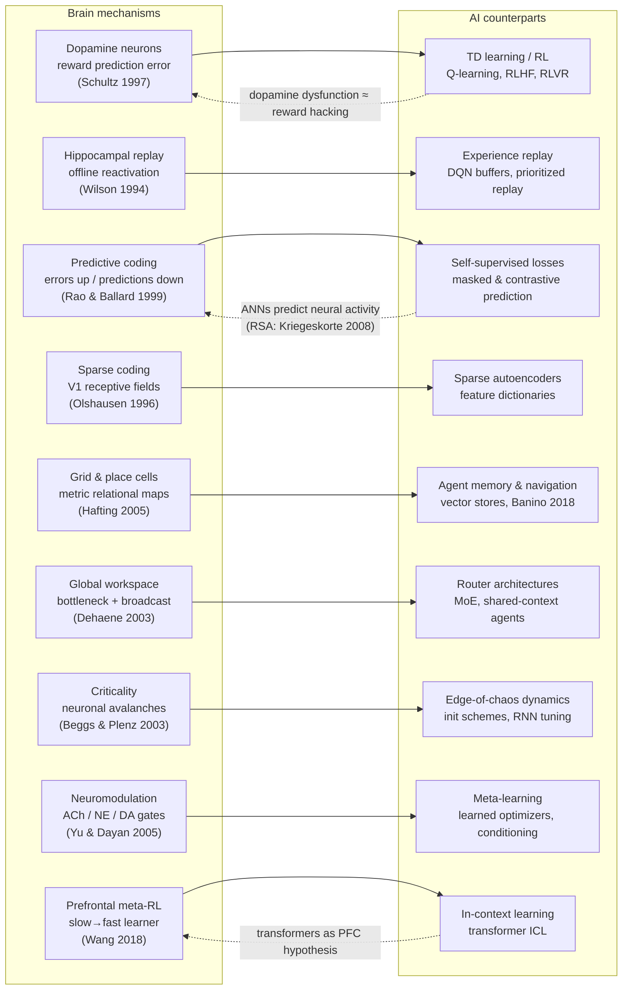

# Diagram — The Neuroscience → AI Bridge

Brain mechanism on the left, engineered counterpart on the right. Solid arrows = "inspired"; dashed = "returned the favor."

**Reading:** every load-bearing AI component has a biological creditor. The return arrows are the 2020s twist: models are now good enough to serve as hypotheses about brains (findings F14).
