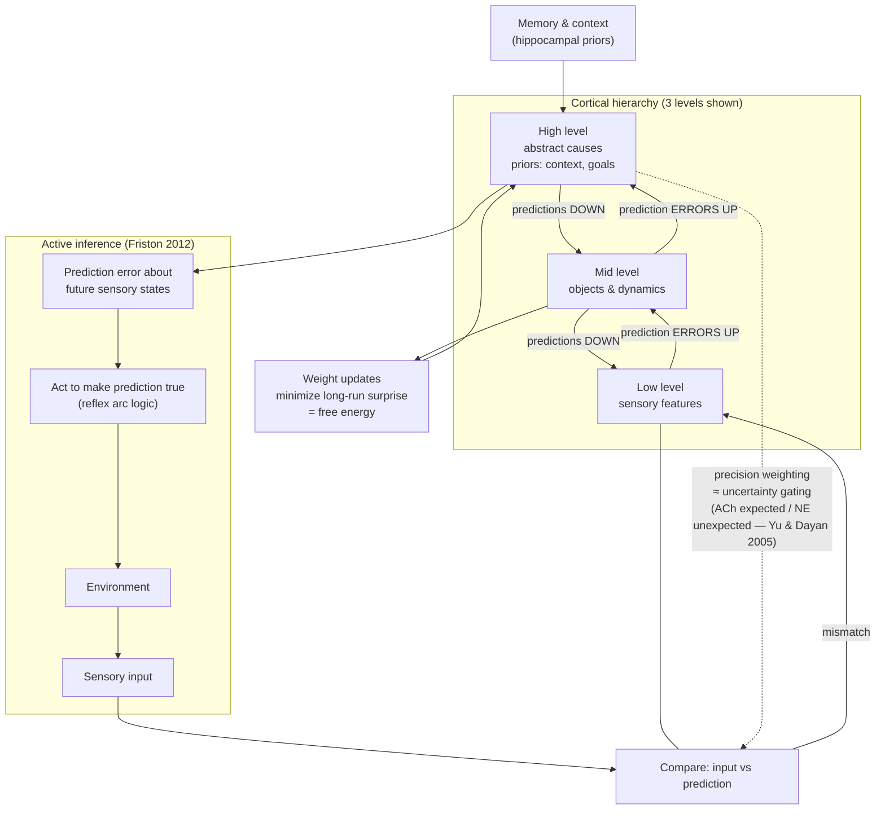

# Diagram — The Predictive Processing / Active Inference Loop

**Parallels to keep in mind:**
- *Predictions down* ≈ generative model; *errors up* ≈ the only signal that travels — the brain's bandwidth budget is spent on surprise, exactly like loss-weighted training and attention.
- *Precision weighting* ≈ learned uncertainty / modality gating — when to trust which errors (cf. ACh/NE neuromodulation).
- *Active inference* closes perception into action: organisms reduce prediction error by ACTING on the world — the philosophical core of world-model agents (domain 05, Dreamer/JEPA/active-inference agents).
- *Weight updates* ≈ learning as slow free-energy minimization vs perception as fast inference — the same objective at two timescales (amortized inference in ML terms).
