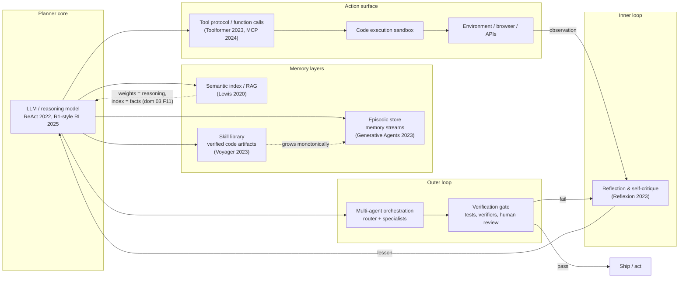

# Diagram — The 2026 Agent Stack (Practical)

What every serious LLM-agent system looks like, and which paper each component descends from.

**Design notes (from findings F10):**
- Spend your novelty budget on the **memory format** (what gets stored after each episode) and the **verifier quality** — those two determine whether the system compounds or plateaus.
- Skills as code (Voyager pattern) beat skills as prose: they're executable, testable, and composable.
- The reflection loop is gradient-free self-improvement; RL fine-tuning (domain 03, F4) is the weight-side complement — use both, they compose.
