# Diagram — The Landscape of New-Intelligence Paradigms

```mermaid
graph TD
    ROOT["Beyond next-token LLMs"]

    ROOT --> WORLD["World-Model Intelligence"]
    WORLD --> WM1["Dreamer V1-V3<br/>2019-2023"]
    WORLD --> WM2["JEPA / I-JEPA / V-JEPA<br/>LeCun 2022-24"]
    WORLD --> WM3["Active inference agents<br/>Friston / Tschantz"]

    ROOT --> ARCH["Architectural Alternatives"]
    ARCH --> A1["State spaces: Mamba 2023<br/>RWKV, Hyena"]
    ARCH --> A2["Learnable basis: KAN 2024"]
    ARCH --> A3["Modern recurrence: xLSTM 2024"]
    ARCH --> A4["Test-time state: TTT 2024<br/>Titans 2025"]
    ARCH --> A5["Diffusion LMs: LLaDA 2025<br/>Mercury, Gemini Diffusion"]

    ROOT --> BIO["Biological Substrates"]
    BIO --> B1["Spiking: Maass 1997<br/>Loihi 2018, SpikeGPT 2023"]
    BIO --> B2["Liquid time-constant<br/>2021"]
    BIO --> B3["Reservoir / echo state<br/>2001"]

    ROOT --> HYBRID["Symbolic Hybrids"]
    HYBRID --> H1["DeepProbLog 2018"]
    HYBRID --> H2["Neuro-symbolic VQA 2019"]
    HYBRID --> H3["ARC solvers 2024-25"]

    ROOT --> COLLECTIVE["Collective Intelligence"]
    COLLECTIVE --> C1["Emergent communication<br/>Lazaridou 2016-18"]
    COLLECTIVE --> C2["Generative agents 2023"]
    COLLECTIVE --> C3["Protocols: MCP 2024<br/>agent swarms"]

    ROOT --> SELFIMP["Self-Improvement + Oversight"]
    SELFIMP --> S1["STaR 2022"]
    SELFIMP --> S2["R1-Zero pure RL 2025"]
    SELFIMP --> S3["Absolute Zero 2025"]
    SELFIMP --> S4["Debate / weak-to-strong<br/>2018-2023"]

    A5 -.->|"parallel generation"| ROOT
    S3 -.->|"needs"| S4
    WM2 -.->|"latent prediction =<br/>predictive coding, dom 04"| WORLD
```

**Compounding combinations (which paradigms stack):**
- World models × architectural alternatives: SSM/TTT backbones make million-step imagination affordable.
- Self-improvement × oversight: every loop (STaR→AZR) needs a verifier story (debate, weak-to-strong) or it Goodharts itself.
- Symbolic hybrids × collective: agent swarms that exchange verified programs (not prose) get compositionality by construction.
- Biological substrates × edge agents: milliwatt sensing loops are the deployment target where cloud LLMs cannot go.
