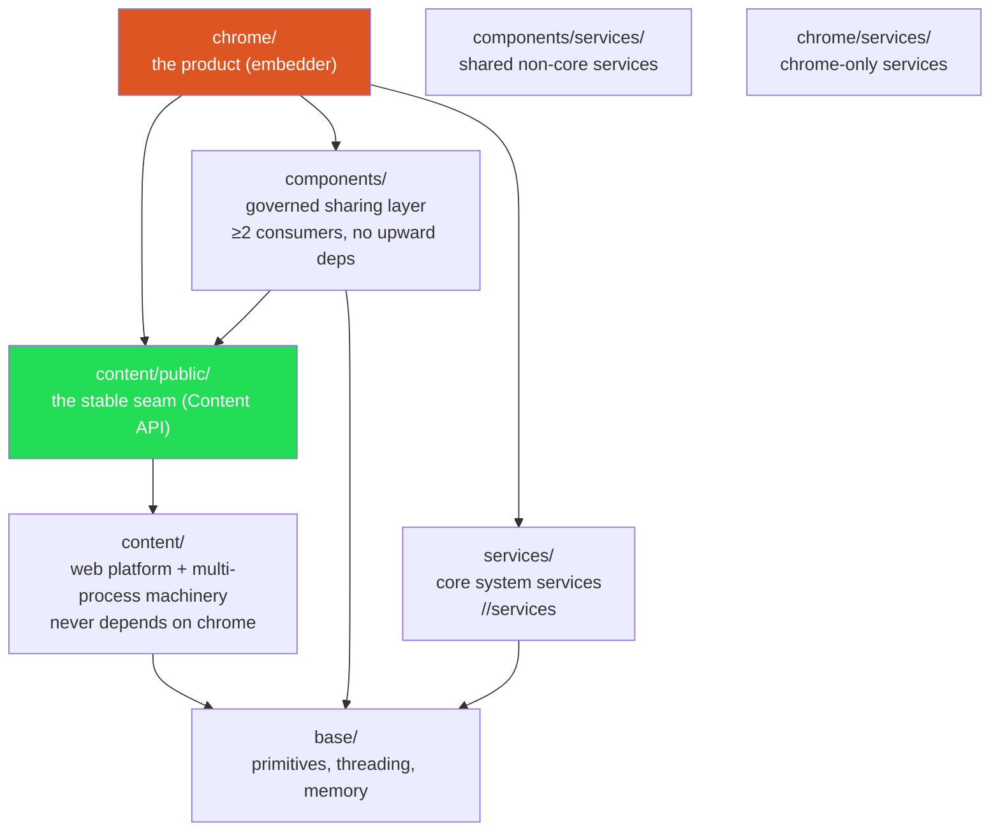

# Chromium Layering & DEPS Enforcement

Dependency direction is law, enforced mechanically by DEPS files (deep dive: `../chromium.md` §4, §9).



The DEPS grammar (deny-by-default, top-down):

```
"-"  deny path prefix        "+allow path prefix"
specific_include_rules = { regex-per-file: [rules] }
new_usages_require_review = True
```

Layering invariants, each a checkable rule:
1. content/ never includes chrome/ ("Do NOT add chrome to the list below").
2. components/ cannot depend on higher layers; no cycles.
3. Intra-layer reach-through banned: `-chrome` inside chrome/ forces explicit subdir declarations.
4. blink access only via `third_party/blink/public/*` — the public/ carve-out pattern again.
5. Test files get their own allowances via `specific_include_rules` regex keys.
