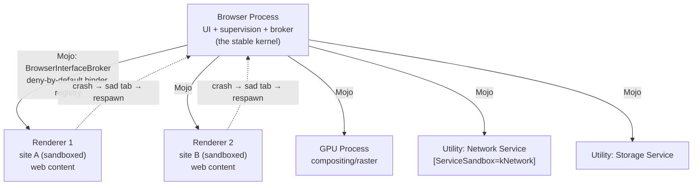

# Chromium Process Map

Process boundaries as failure + trust domains (deep dive: `../chromium.md` §1–3). Mojo connects everything; the endpoint's location is hidden, so any unit can move in-process ↔ out-of-process.

Key rules visible in the map:
- One process per **site** (eTLD+1), not per tab — the data-policy boundary is the trust boundary.
- Renderers are assumed compromised; cross-site data only enters with CORS permission.
- All renderer→browser interface requests pass the broker; an unregistered binder **terminates the renderer** (fail closed).
- Crash recovery is mechanical: watch the channel, respawn on failure.
