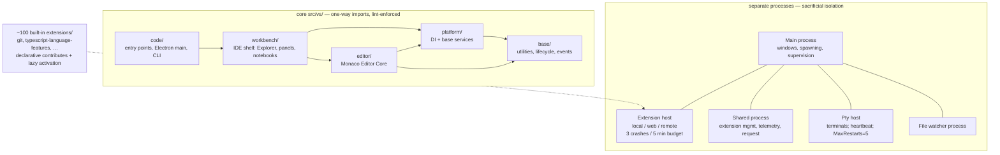

# VS Code Layer & Process Map

Layer gradient + process isolation (deep dive: `../vscode.md` §1–6).

The two orthogonal rules that compose:
1. **Imports flow downhill** (`code-import-patterns` whitelist, "do not relax") — base never imports up; each layer whitelists what it may touch.
2. **Volatile code runs sideways** — extensions, terminals, file watching, telemetry all live in separate processes with health signals and bounded restarts, so a hang degrades one feature, never the UI.
