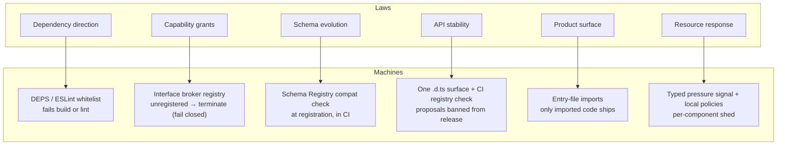

# Where Structure Gets Enforced (It's Never in Code Review)

The pattern across both codebases: every structural law has a machine that enforces it (findings: `../findings.md` F1–F14).

The rule: **if a law has no machine, it is a suggestion.** Every finding in this corpus that survived at scale acquired an enforcement mechanism — deny-by-default grammar, whitelist table, registration check, bounded restart, typed signal. Code review is for judgment calls the machines can't express; everything else gets a machine.
