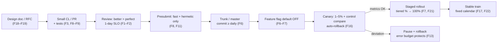

# The Big-Tech Release Pipeline

How code reaches users at Google/Meta/Microsoft scale (findings: `../findings.md` F6–F7, F13, F16–F17, F21–F22).

The three decouplings that make this pipeline work:
1. **Deploy ≠ release** — flags (Gatekeeper, FeatureList) let code ship dark and expose per-cohort (F6–F7).
2. **Release ≠ feature readiness** — the fixed train means missing a deadline costs weeks, not a slipped branch (F17, F22).
3. **Velocity ≠ risk** — the error budget is the shared number that decides whether to ship or freeze (F13).
