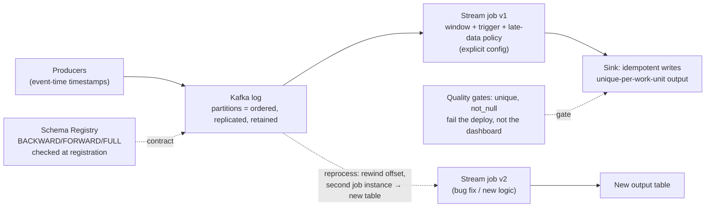

# Kappa: The Log-Centric Pipeline

One path, replayable from the log (findings: `../findings.md` F1–F8, F13).

The load-bearing decisions:
1. **One path** (Kappa): same logic for history and live — bug fixes apply to the past at next reprocess (F6).
2. **Event time + watermarks** carried end-to-end: results reproducible across reprocessing runs (F3–F4).
3. **Idempotent sinks**: at-least-once delivery + unique output naming = exactly-once effects (F5).
4. **Backpressure at the boundary**: pause partitions instead of buffering in consumer memory (F7–F8).
5. **Schema + quality gates as commits-time checks**: breaking change = rejected registration, bad data = failed deploy (F9, F13).
