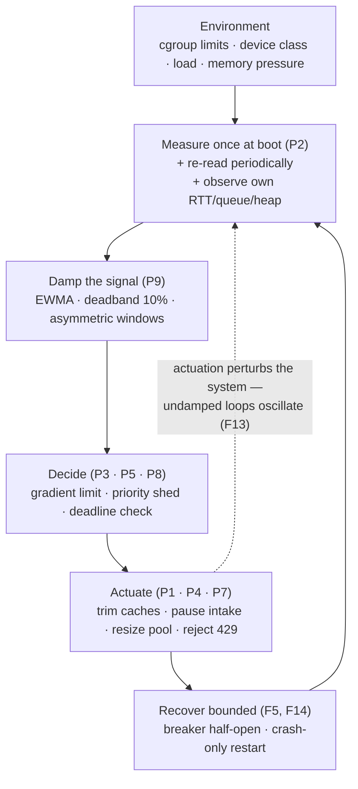

# The Adaptive Loop

Every adaptive behavior in this corpus is the same loop with different sensors and actuators (findings: `../findings.md`, patterns: `../patterns.md`).

The four invariants across every verified system:
1. **Degrade before die** — soft limits, pressure levels, shedding: latency is recoverable, state loss is not (F1, F2, F14).
2. **Signals are typed and coarse** — NONE/MODERATE/CRITICAL, device classes, windowed failure counts. Precision lives in the component's local policy (F1, F5).
3. **Controllers are damped** — deadband + EWMA + asymmetric speed, or they oscillate themselves to death (F13).
4. **Rejection is designed** — 429 with `Retry-After`, jittered and budgeted, is the overload response; hidden queues are the bug (F6, F11, F14).
