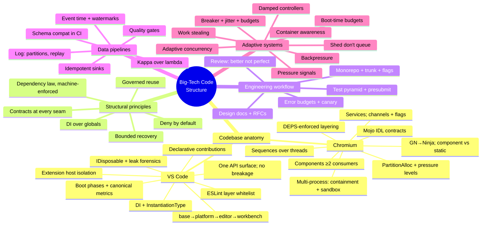

# Master Map

The whole corpus in one mindmap, then goal-based reading orders. Compiled 2026-10-25.

## Reading orders

**"I'm about to start a new project" (90 min)**
1. [PERSONA.md](PERSONA.md) — adopt the mindset (10 min)
2. [02_structural-principles/findings.md](02_structural-principles/findings.md) — the structure rules (25 min)
3. [PLAYBOOK.md](PLAYBOOK.md) — memorize the checklist (10 min)
4. [05_adaptive-systems/patterns.md](05_adaptive-systems/patterns.md) — P1, P2, P4 now; the rest when needed (30 min)
5. [03_engineering-workflow/findings.md](03_engineering-workflow/findings.md) F18–F19, F25–F27 — set up docs, review, tests (15 min)

**"My service falls over under load" (60 min)**
1. [05_adaptive-systems/findings.md](05_adaptive-systems/findings.md) — all (30 min)
2. [05_adaptive-systems/patterns.md](05_adaptive-systems/patterns.md) — P2, P3, P5, P6, P9 (20 min)
3. [04_data-pipelines/findings.md](04_data-pipelines/findings.md) F7–F8 — if data flows through (10 min)

**"I'm building a plugin/extension system" (75 min)**
1. [01_codebase-anatomy/vscode.md](01_codebase-anatomy/vscode.md) §6–§8 (25 min)
2. [01_codebase-anatomy/chromium.md](01_codebase-anatomy/chromium.md) §3 (Mojo) (20 min)
3. [02_structural-principles/findings.md](02_structural-principles/findings.md) F2, F12 (15 min)
4. [PLAYBOOK.md](PLAYBOOK.md) R9, R13, R14 (15 min)

**"I'm moving data at scale" (60 min)**
1. [04_data-pipelines/findings.md](04_data-pipelines/findings.md) — all (35 min)
2. [04_data-pipelines/diagrams/kappa-flow.md](04_data-pipelines/diagrams/kappa-flow.md) (5 min)
3. [05_adaptive-systems/patterns.md](05_adaptive-systems/patterns.md) P4 (10 min)
4. [03_engineering-workflow/findings.md](03_engineering-workflow/findings.md) F24 quality gates context (10 min)

**"I want to understand how Chromium/VS Code actually work" (2–3 h)**
1. [01_codebase-anatomy/chromium.md](01_codebase-anatomy/chromium.md) — full, with diagrams
2. [01_codebase-anatomy/vscode.md](01_codebase-anatomy/vscode.md) — full, with diagrams
3. [01_codebase-anatomy/findings.md](01_codebase-anatomy/findings.md) — the agreement between them
4. Follow any primary source that surprised you

**"I'm an agent with 15 minutes"**
1. [AGENTS.md](AGENTS.md) (2 min) → 2. [PLAYBOOK.md](PLAYBOOK.md) checklist (5 min) → 3. grep the findings for your task's keywords (8 min)
